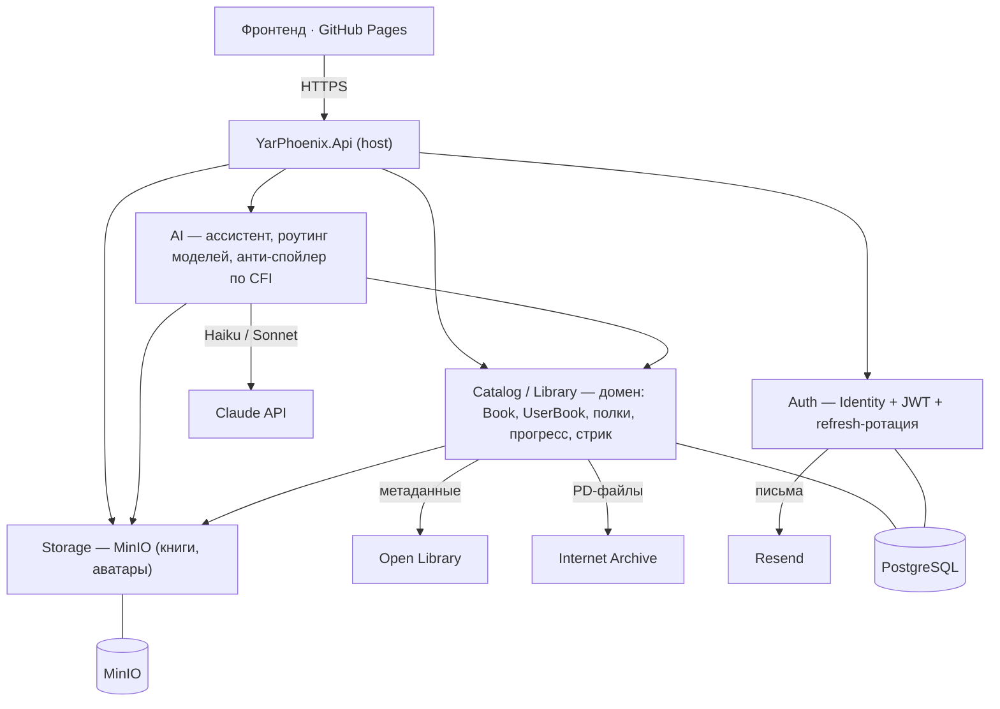

# YarPhoenix Library — бэкенд (API)

Веб-сервис для чтения книг: каталог, личная библиотека, читалка и AI-ассистент.
Это **бэкенд** на ASP.NET Core. Фронтенд (React + Vite) — в
[отдельном репозитории](https://github.com/yarphoenix/yarphoenix-library).

> Портфолио-проект под стажировку C#/.NET. Ставка — на инженерную зрелость: осознанно
> простая архитектура (модульный монолит, а не микросервисы «на показ»), устойчивость к
> сбоям на границах с внешними зависимостями и юридическая чистота домена.

## Архитектура: модульный монолит

Один процесс, внутри — модули с жёсткими границами (отдельные проекты, своя схема БД).
Границы проведены так, что модуль можно вынести в сервис, когда это действительно
понадобится, — но без налога распределённой системы сейчас.



## Два мира контента

Домен построен на **двух типах контента** (одна сущность `Book` с двумя nullable-ссылками):

- `ExternalId` + `Provider` → книга видна в каталоге (мир A, метаданные).
- `FileId` → книга читаема в сервисе с AI (мир B, файл в MinIO).

AI и читалку открывает **наличие файла**, а не полка. PD-книги (Internet Archive) при
клике «Читать» лениво докачиваются в MinIO — «золотой случай»: одна запись получает и
метаданные, и файл. PD-статус проверяется **нами** (вайтлист авторов-классиков + фильтр
lending-книг IA), а не тегами стороннего сайта (§5.1.2).

## Устойчивость (Polly)

На каждой границе с внешней зависимостью — своя копия конвейера
**Retry → CircuitBreaker → Timeout** (`Microsoft.Extensions.Http.Resilience`): Claude,
MinIO, Open Library, Internet Archive, Resend. Fallback возвращает **значение, а не
исключение**: отказ ассистента не роняет запрос читалки, эндпоинт отвечает 200 с
`available:false`, а не 500.

## AI-ассистент без спойлеров

Всё, что уходит в модель, обрезано по позиции чтения (CFI) — анти-спойлер **на уровне
данных** (§7.2). Сервер открывает EPUB из MinIO, извлекает текст по главам (spine),
разрешает CFI в границу «прочитанного» и режет окно контекста под шаблон. Любая
неоднозначность CFI смещает границу назад (меньше контекста), никогда вперёд.
Дешёвые шаблоны → Haiku, интерпретационные → Sonnet.

## Auth

ASP.NET Core Identity (хранилище, PBKDF2, lockout) + JWT/refresh поверх для API.
Refresh-токены хранятся только как SHA-256 хэш, ротируются при обновлении;
повторное предъявление ротированного токена трактуется как кража → все сессии гасятся.
Письма (подтверждение почты, сброс пароля, смена почты) — через Resend, с мягкой
деградацией в лог при отсутствии ключа.

## Стек

C#, ASP.NET Core, EF Core + PostgreSQL, MinIO, Claude API. Clean Architecture внутри
модулей, Result-паттерн. Кэш — HybridCache. Тесты — xUnit. OpenAPI-документ
(`/openapi/v1.json`, только в Development) — источник типов для фронтенда: его TypeScript-типы
генерируются из схемы, а не пишутся руками.

## Локальный запуск

```bash
# зависимости
docker compose up -d postgres minio

# API (порт 5080); ключи Claude/Resend опциональны — фичи деградируют мягко
dotnet run --project src/YarPhoenix.Api

dotnet test          # юнит-тесты
```

`appsettings.Development.json` содержит только несекретные настройки (адрес MinIO, демо-учётка).
Строка подключения, ключи MinIO и секрет JWT лежат в user-secrets вне репозитория — задайте
их один раз значениями из своего `.env`:

```bash
dotnet user-secrets set "ConnectionStrings:Postgres" "Host=127.0.0.1;Port=5433;Database=<POSTGRES_DB>;Username=<POSTGRES_USER>;Password=<POSTGRES_PASSWORD>" --project src/YarPhoenix.Api
dotnet user-secrets set "Minio:AccessKey" "<MINIO_ROOT_USER>" --project src/YarPhoenix.Api
dotnet user-secrets set "Minio:SecretKey" "<MINIO_ROOT_PASSWORD>" --project src/YarPhoenix.Api
dotnet user-secrets set "Jwt:Secret" "<случайная строка от 32 символов>" --project src/YarPhoenix.Api
```

В окружении Development при старте создаётся демо-пользователь `reader@example.com` /
`password123` (секция `DevSeed`); в Production сидер не запускается. Прокси для Open Library /
Internet Archive / Claude — через env `HTTP(S)_PROXY`, если провайдер их блокирует.

## Деплой

Бэкенд + PostgreSQL + MinIO + Caddy (авто-TLS) — Docker на VPS. Пошаговый runbook:
[docs/DEPLOY.md](docs/DEPLOY.md). CI (`.github/workflows/backend.yml`): build с
`-warnaserror` и `dotnet test` на каждый push/PR; push в основную ветку публикует образ в
GHCR; деплой на VPS запускается вручную кнопкой Run workflow.

## Тесты

xUnit, два проекта. Покрыто: логика стрика, роутинг шаблонов ассистента и анти-спойлер,
парсер CFI и извлечение текста EPUB, фильтр lending / вайтлист Internet Archive, парсинг
OPF, ротация и reuse-detection refresh-токенов.
