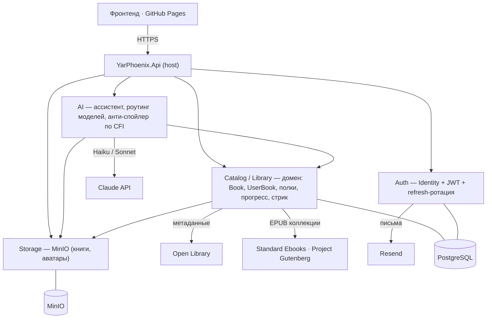

# YarPhoenix Library — бэкенд (API)

Веб-сервис для чтения книг: каталог, личная библиотека, читалка и AI-ассистент.
Это **бэкенд** на ASP.NET Core. Фронтенд (React + Vite) — в
[отдельном репозитории](https://github.com/yarphoenix/yarphoenix-library).

> Портфолио-проект под стажировку C#/.NET. Ставка — на инженерную зрелость: осознанно
> простая архитектура (модульный монолит, а не микросервисы «на показ»), устойчивость к
> сбоям на границах с внешними зависимостями и юридическая чистота домена.

## Архитектура: модульный монолит

Один процесс, внутри — модули с жёсткими границами (отдельные проекты, своя схема БД).
Границы проведены так, что модуль можно вынести в сервис, когда это действительно
понадобится, — но без налога распределённой системы сейчас.



## Два мира контента

Домен построен на **двух типах контента** (одна сущность `Book` с двумя nullable-ссылками):

- `ExternalId` + `Provider` → книга видна в каталоге (мир A, метаданные).
- `FileId` → книга читаема в сервисе с AI (мир B, файл в MinIO).

AI и читалку открывает **наличие файла**, а не полка. У книги читаемой коллекции файл
появляется при первом клике «Читать»: он лениво скачивается в MinIO, и одна запись получает и
метаданные, и текст. EPUB, загруженный пользователем, остаётся его личной записью: из
совпавшей каталожной записи берутся только метаданные, чужой файл в общую запись не попадает.

## Читаемая коллекция

Главная страница каталога — не живой поиск по Open Library, а **коллекция в PostgreSQL**:
только книги, которые действительно можно открыть и читать.

- **Источник текстов** — вычитанные EPUB [Standard Ebooks](https://standardebooks.org) и
  [Project Gutenberg](https://www.gutenberg.org). Мост «каталог → файл» — идентификаторы
  `id_standard_ebooks` / `id_project_gutenberg` в записях Open Library, без сопоставления по
  названию. Это осознанное отступление от ТЗ §5.1.2 (там слот файлов — Internet Archive):
  авто-EPUB из OCR-сканов давали текст с ошибками распознавания.
- **Импорт** (`ReadableCollectionImporter`, фоновый сервис): при пустой коллекции и затем раз в
  неделю проходит выдачу Open Library, сверяется с официальным каталогом Gutenberg
  (`pg_catalog.csv`) и делает идемпотентный upsert по `(Provider, ExternalId)`. Проход
  возобновляемый — страница сохраняется после каждого шага.
- **Что попадает в коллекцию:** английский текст (не перевод на другой язык, не аудио, по
  возможности книга целиком, а не отдельный том), название, автор и обложка, общественное
  достояние.
- **Общественное достояние проверяем сами**, а не верим тегам сайта: все создатели издания,
  включая переводчиков, умерли не менее 75 лет назад (срок охраны в РФ — 70 лет, плюс 4 года
  для работавших в войну, плюс запас). Год смерти неизвестен — книга пропускается, кроме
  бесспорной классики из вайтлиста.
- **Каталог:** `GET /api/catalog/books` отдаёт коллекцию (поиск по названию и автору, жанр,
  порядок — по числу изданий); `scope=all` включает живой поиск по всему Open Library, где
  читаемые книги помечены `isReadable`. Язык интерфейса выдачу не фильтрует.

## Устойчивость (Polly)

На каждой границе с внешней зависимостью — своя копия конвейера
**Retry → CircuitBreaker → Timeout** (`Microsoft.Extensions.Http.Resilience`): Claude,
MinIO, Open Library, источники файлов коллекции, Resend. Fallback возвращает **значение, а не
исключение**: отказ ассистента не роняет запрос читалки, эндпоинт отвечает 200 с
`available:false`, а не 500; недоступный источник книги — это 503 с понятным сообщением, и
следующее «Читать» попробует снова.

## AI-ассистент без спойлеров

Всё, что уходит в модель, обрезано по позиции чтения (CFI) — анти-спойлер **на уровне
данных** (§7.2). Сервер открывает EPUB из MinIO, извлекает текст по главам (spine),
разрешает CFI в границу «прочитанного» и режет окно контекста под шаблон. Любая
неоднозначность CFI смещает границу назад (меньше контекста), никогда вперёд.
Дешёвые шаблоны → Haiku, интерпретационные → Sonnet.

## Auth

ASP.NET Core Identity (хранилище, PBKDF2, lockout) + JWT/refresh поверх для API.
Refresh-токены хранятся только как SHA-256 хэш, ротируются при обновлении;
повторное предъявление ротированного токена трактуется как кража → все сессии гасятся.
Письма (подтверждение почты, сброс пароля, смена почты) — через Resend, с мягкой
деградацией в лог при отсутствии ключа.

## Стек

C#, ASP.NET Core, EF Core + PostgreSQL, MinIO, Claude API. Clean Architecture внутри
модулей, Result-паттерн. Кэш — HybridCache. Тесты — xUnit. OpenAPI-документ
(`/openapi/v1.json`, только в Development) — источник типов для фронтенда: его TypeScript-типы
генерируются из схемы, а не пишутся руками.

## Локальный запуск

```bash
# зависимости
docker compose up -d postgres minio

# API (порт 5080); ключи Claude/Resend опциональны — фичи деградируют мягко
dotnet run --project src/YarPhoenix.Api

dotnet test          # юнит-тесты
```

`appsettings.Development.json` содержит только несекретные настройки (адрес MinIO, демо-учётка).
Строка подключения, ключи MinIO и секрет JWT лежат в user-secrets вне репозитория — задайте
их один раз значениями из своего `.env`:

```bash
dotnet user-secrets set "ConnectionStrings:Postgres" "Host=127.0.0.1;Port=5433;Database=<POSTGRES_DB>;Username=<POSTGRES_USER>;Password=<POSTGRES_PASSWORD>" --project src/YarPhoenix.Api
dotnet user-secrets set "Minio:AccessKey" "<MINIO_ROOT_USER>" --project src/YarPhoenix.Api
dotnet user-secrets set "Minio:SecretKey" "<MINIO_ROOT_PASSWORD>" --project src/YarPhoenix.Api
dotnet user-secrets set "Jwt:Secret" "<случайная строка от 32 символов>" --project src/YarPhoenix.Api
```

В окружении Development при старте создаётся демо-пользователь `reader@example.com` /
`password123` (секция `DevSeed`); в Production сидер не запускается. Прокси для Open Library,
Project Gutenberg, Standard Ebooks и Claude — через env `HTTP(S)_PROXY`, если провайдер их
блокирует.

При первом запуске фоновый импорт за несколько минут собирает читаемую коллекцию (прогресс — в
логах, книги появляются на витрине по мере импорта). Для работы без сети его можно выключить:
`Collection__ImportEnabled=false`.

## Деплой

Бэкенд + PostgreSQL + MinIO + Caddy (авто-TLS) — Docker на VPS. Пошаговый runbook:
[docs/DEPLOY.md](docs/DEPLOY.md). CI (`.github/workflows/backend.yml`): build с
`-warnaserror` и `dotnet test` на каждый push/PR; push в основную ветку публикует образ в
GHCR; деплой на VPS запускается вручную кнопкой Run workflow.

## Тесты

xUnit, два проекта. Покрыто: логика стрика, роутинг шаблонов ассистента и анти-спойлер,
парсер CFI и извлечение текста EPUB, импорт коллекции (разбор каталога Gutenberg, выбор
издания, правило общественного достояния, фильтр качества), чистка данных Open Library
(описания, темы, экранирование запроса), парсинг OPF, ротация и reuse-detection
refresh-токенов.
